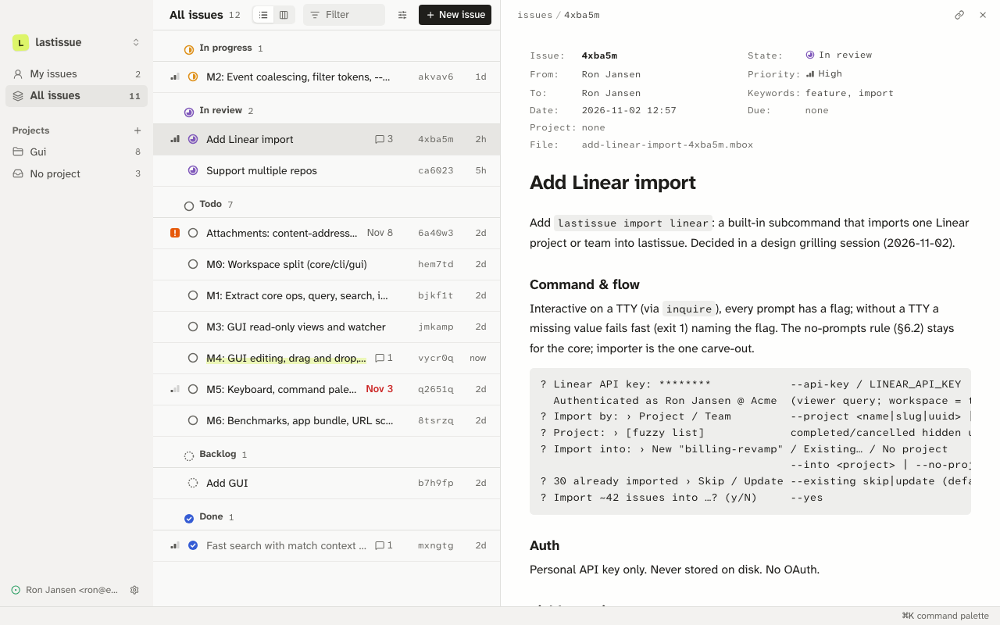
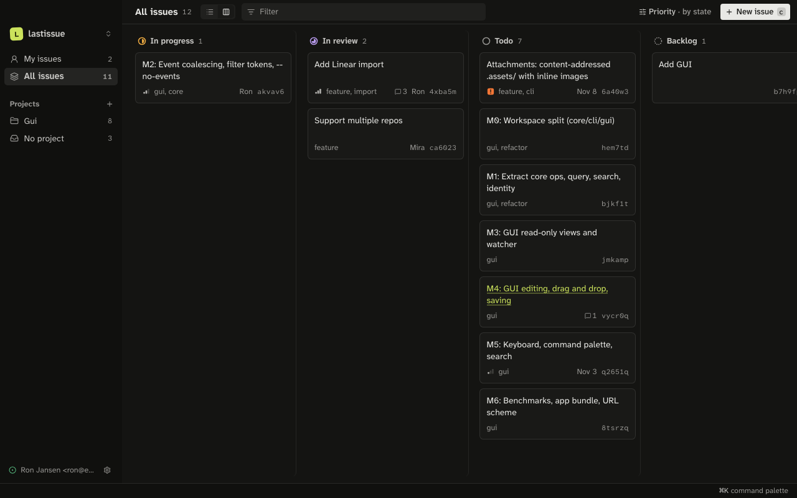

<div align="center">


# lastissue

**Plaintext, local-first issue tracker.**

Plaintext local issue tracker based on mbox file format, with a 
desktop app for humans and a CLI for AI agents. No server. No database.

[](https://github.com/ronxjansen/lastissue/releases/latest)


[**Download**](https://github.com/ronxjansen/lastissue/releases/latest) · [Quick start](#quick-start) · [For AI agents](#built-for-ai-agents) · [File format](crates/core/README.md)

<br>



</div>

<br>

## Why lastissue?

I wanted a dead-simple, boring issue tracker that is optimized for LLM usage, 
but also intuitive. It's heavily inspired on how modern issue tracker work, 
but also on the file-over-app philosophy from Obisidian. I did not want any
dependencies and yet a fast, pretty, local- and AI-first issue tracker. I tried
to 

- 📄 **Plaintext mbox file formats.** Every issue is one `.mbox` file in `issues/`. Read it with
  `cat`, search it with `grep`, open it in `mutt -f`.
- 🌿 **Git agnostic.** Branch, review and merge issues with the same pull
  request that fixes them. Works offline, on a plane, forever. Or just gitignore
  the entire directory if you want to keep them out of git. 
- 🤖 **Built for agents.** Claude Code, Codex, Cursor and friends can create,
  triage and comment on issues with a CLI whose `--help` is the whole manual.
- 🖥️ **Intuitive and fast desktop app.** List and board views, a `⌘K` command
  palette, keyboard-first everything, light and dark themes.
- ⚡ **Fast at scale.** Parallel scans and no index to rebuild. The app stays
  smooth at 50,000 issues.
- 🚚 **Bring your backlog.** One command imports a Linear project or team,
  comments included.

<div align="center">

</div>

## Why mbox?

Issues are essentially conversations. 50 years ago issues were email threads send to a 
whole group of maintainers. Today the essence of managing issues has not changed, only 
the interface has changed dramatically. Each issue was a single file with a few headers 
on top and its comments stacked underneath as messages. 

Since I wanted to build something that is flexible to use and hopefully withstand the test 
of time, I wanted to build on dead boring fundamentals. And what is simpler then a plaintext 
file format with a bunch of conventions built-in, that is supported by a wide variety 
of protocols?

## Quick start

```sh
cd your-project
lastissue init
lastissue issue create --title "Login crashes on empty password" --label bug --priority high
lastissue issue list --filter "is:ready @me"
```

That's it. You now have an `issues/` folder. Commit it, push it, and your team
has it too.

```text
your-project/
├── src/
└── issues/
    ├── login-crashes-on-empty-7hq2mz.mbox
    └── billing-revamp-45aef68/
        └── stripe-webhook-retries-a8k3pd.mbox
```

## Install

### Download

Grab the latest build from [**Releases**](https://github.com/ronxjansen/lastissue/releases/latest):

| Platform | CLI | Desktop app |
|---|---|---|
| macOS (Apple Silicon) | `lastissue-*-aarch64-apple-darwin.tar.gz` | `.dmg` |
| macOS (Intel) | `lastissue-*-x86_64-apple-darwin.tar.gz` | `.dmg` |
| Linux (x86_64) | `lastissue-*-x86_64-unknown-linux-gnu.tar.gz` | – |

> [!NOTE]
> The macOS app is not signed yet. After moving it to Applications, run
> `xattr -dr com.apple.quarantine /Applications/lastissue.app` once, or
> right-click it and choose **Open**.

### From source

Needs Rust (version pinned in `rust-toolchain.toml`) and, for the desktop app, pnpm.

```sh
git clone https://github.com/ronxjansen/lastissue
cd lastissue
make build     # CLI and desktop app
make install   # CLI into ~/.cargo/bin, app into /Applications
```

## Built for AI agents

Agents don't need an MCP server, an API token or a browser. Just point it at the CLI. 

```sh
# Find work that isn't blocked by anything
lastissue issue list --ready --brief
# 7hq2mz  todo  high  bug,auth  Login crashes on empty password

# Pick it up and report back
export LASTISSUE_SENDER="Claude Code <claude@agent>"
lastissue issue update 7hq2mz --state in-progress
lastissue comment create 7hq2mz --body "Root cause: unwrap() in auth.rs:41. Fix in #212."
```

- **Plain text.** Output is plain RFC 5322 headers, an easy to read for both humans and 
  LLMs. 
- **Errors that teach.** A bad value names every valid one, so the agent fixes
  itself on the next try.
- **Search with context.** `--search` tells you where each hit is: subject,
  body or comment *n*, with a snippet.
- **Know who did what.** Writes from agents carry a `Sender:` header. Filter
  them with `--agent`.

## Filters

The same filter operators works in the CLI and in the app:

```text
is:ready @me                     ready to start, assigned to me
state:in-review label:auth       auth issues waiting for review
p:urgent due:<7d                 urgent and due within a week
project:billing "webhook retry"  phrase search inside one project
```

## Mbox

Open any file and you can read it. It's essentially just old fashioned email:

```text
From 7hq2mz@lastissue Mon Nov  2 13:05:56 2026
Message-ID: <01JBXK…7HQ2MZ@lastissue>
From: Ron <ron@example.com>
To: claude@agent
Subject: Login crashes on empty password
X-Issue-State: todo
X-Priority-Level: high
Keywords: bug, auth

Submitting the login form with an empty password panics the server.
```

Comments and history are more messages in the same file. The full format is in
[`crates/core/README.md`](crates/core/README.md).

## Development

| Command | Does |
|---|---|
| `make install` | Installs `lastissue` into `~/.cargo/bin` and the app built by `make build` into `/Applications` |
| `make dev` | Runs the desktop app with hot reload |
| `make bundle` | Builds an unsigned `lastissue.app` and `.dmg` under `target/release/bundle/` |
| `make build` | Release builds of the CLI and `lastissue.app` (no `.dmg`) |
| `make test` | `cargo test --workspace`, then `svelte-check` and `vitest` |
| `make bench` | Core scale benchmarks (10k and 100k synthetic issues) |

The repo is a Cargo workspace with three crates:

- [`crates/core`](crates/core/README.md): the file format, data model and every operation
- [`crates/cli`](crates/cli/README.md): the `lastissue` binary
- [`crates/desktop`](crates/desktop/README.md): the Tauri + Svelte desktop app

<details>
<summary><b>Conventions</b></summary>

- One virtual Cargo manifest (`resolver = "3"`, edition 2024). Every
  dependency version is pinned once in `[workspace.dependencies]`.
- Lints: `unsafe_code = "forbid"`, clippy `pedantic` as warnings with a short
  list of allows. Every crate sets `[lints] workspace = true`.
- No async and no database anywhere.

</details>

<details>
<summary><b>Releasing</b></summary>

Releases are automated with [release-please](https://github.com/googleapis/release-please).
Write commits as [Conventional Commits](https://www.conventionalcommits.org/)
(`feat:`, `fix:`, `perf:`, `feat!:` for breaking changes). On every push to
`master`, release-please keeps a release PR open that bumps the version
(workspace `Cargo.toml`, `Cargo.lock`, `package.json`, `tauri.conf.json`) and
updates [`CHANGELOG.md`](CHANGELOG.md). Merging that PR tags `vX.Y.Z`, creates
the GitHub release and attaches CLI binaries (macOS arm64/x86_64, Linux x86_64)
and an unsigned macOS `.dmg`.

Before 1.0, `feat` and breaking changes bump the minor version; `fix` and
`perf` bump the patch version.

</details>

<details>
<summary><b>Not in v1</b></summary>

JSON output, attachments, locks, a merge driver, auto-commits, auto-expiry,
notifications, a web view, project metadata, nested projects, multiple
assignees, configurable workflows and a full-text index.

</details>
